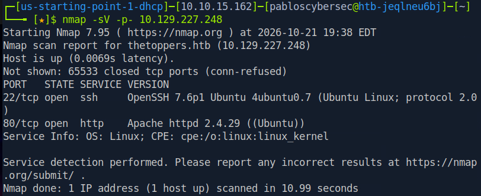
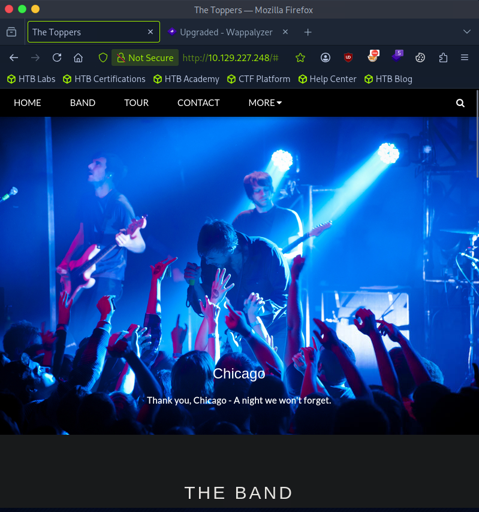
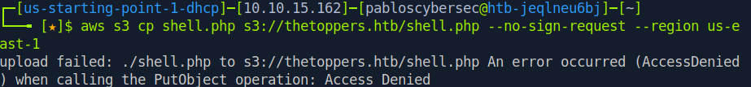

# Recon — Three

## 1. Port scan

```bash
nmap -sV -p- 10.129.227.248
```

**Result**: only two ports open.

| Port | Service |
|------|---------|
| 22   | OpenSSH |
| 80   | Apache (HTTP) |

No FTP, no SMB — smaller surface than most Starting Point boxes, which was the first hint this one wouldn't follow the usual "leaked backup file" pattern.



## 2. Web enumeration

Browsed the site in Firefox — a band website ("The Toppers") with Home / Band / Tour / Contact pages.

**Contact page** revealed an email address:

```
mail@thetoppers.htb
```



→ domain: `thetoppers.htb`. Added it to `/etc/hosts`:

```bash
echo "10.129.227.248 thetoppers.htb" | sudo tee -a /etc/hosts
```

### Directory brute-force

```bash
gobuster dir -u http://thetoppers.htb \
  -w /usr/share/wordlists/dirbuster/directory-list-2.3-medium.txt \
  -x php,txt,html,zip,bak
```

Found only `index.php` (200) and `images/` (301, directory listing enabled — just band photos, nothing sensitive). No backup files, no FTP/SMB to pivot through. This ruled out the "exposed backup.zip / leaked credentials" path common on other boxes.


### Wappalyzer fingerprint

Checked the site's stack with the Wappalyzer browser extension: W3.CSS, Font Awesome, Google Fonts, Cloudflare CDN. No CMS, no detectable backend framework beyond plain PHP — confirming there was no obvious CVE angle to chase either.

## 3. Finding the real hosting location

Checking the page source / HTTP behavior showed the site's actual content wasn't served from the box's own filesystem — it pointed to an **AWS S3 bucket** named after the domain.

Confirmed the S3 subdomain:

```bash
curl -s http://thetoppers.htb/ | grep -i amazonaws
```

→ `s3.amazonaws.com`

This explained why gobuster and the file-hunting steps had come up empty: there was no local filesystem to brute-force. The site's "files" lived in cloud storage, addressed through `s3.thetoppers.htb` in this lab's local DNS.

```bash
echo "10.129.227.248 s3.thetoppers.htb" | sudo tee -a /etc/hosts
```

Confirmed the bucket exists (public AWS endpoint returned `AccessDenied`, not `NoSuchBucket` — meaning the name is right, access is just not routed through real AWS):

```bash
curl http://thetoppers.htb.s3.amazonaws.com/
```



Next: [`exploitation.md`](./exploitation.md)
